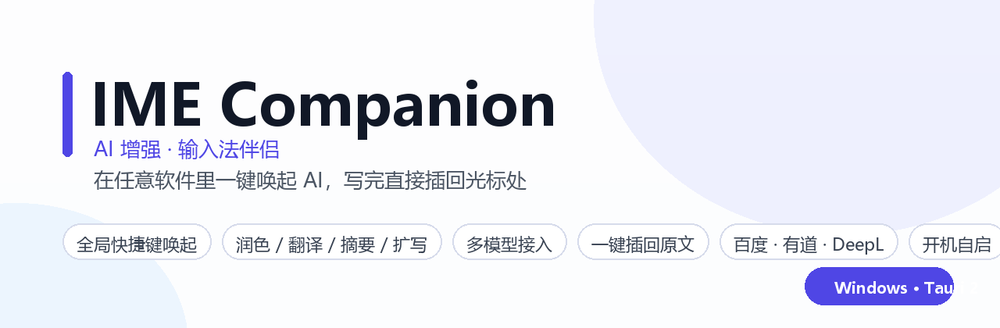
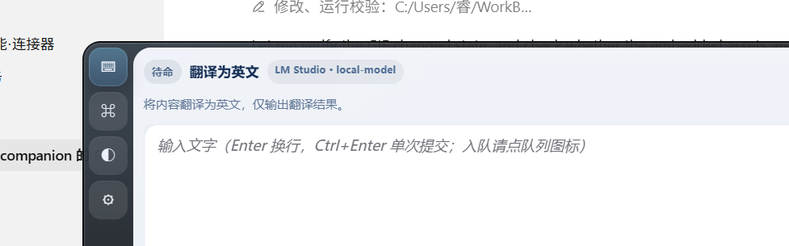
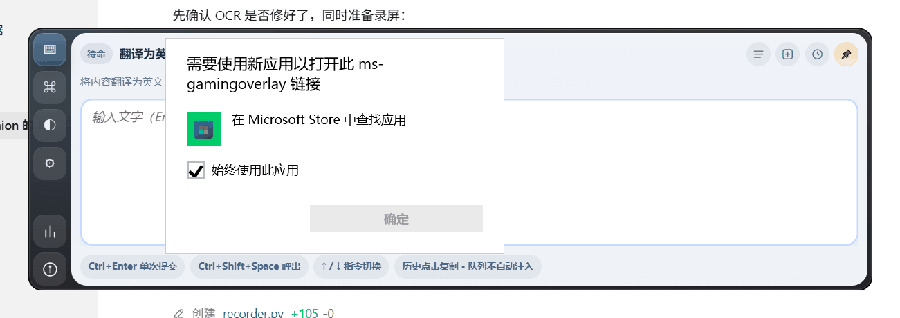
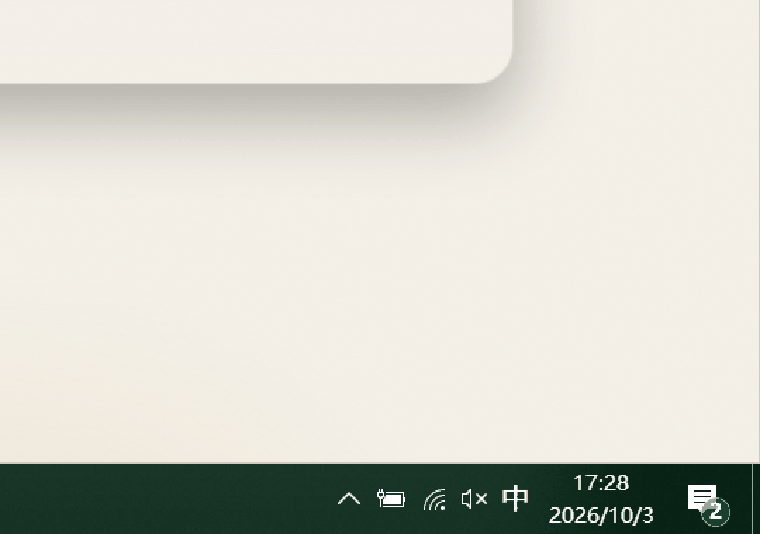
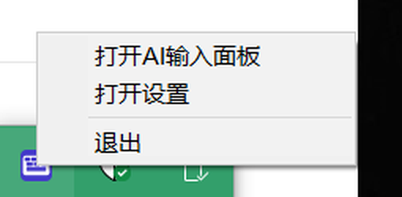
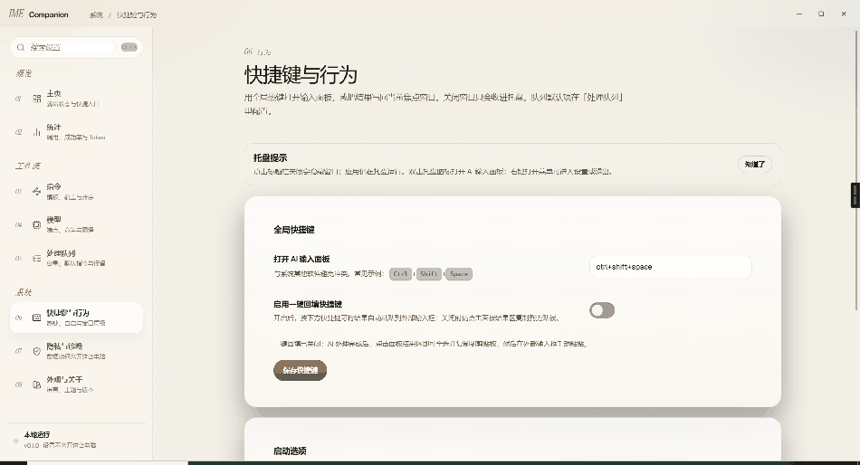
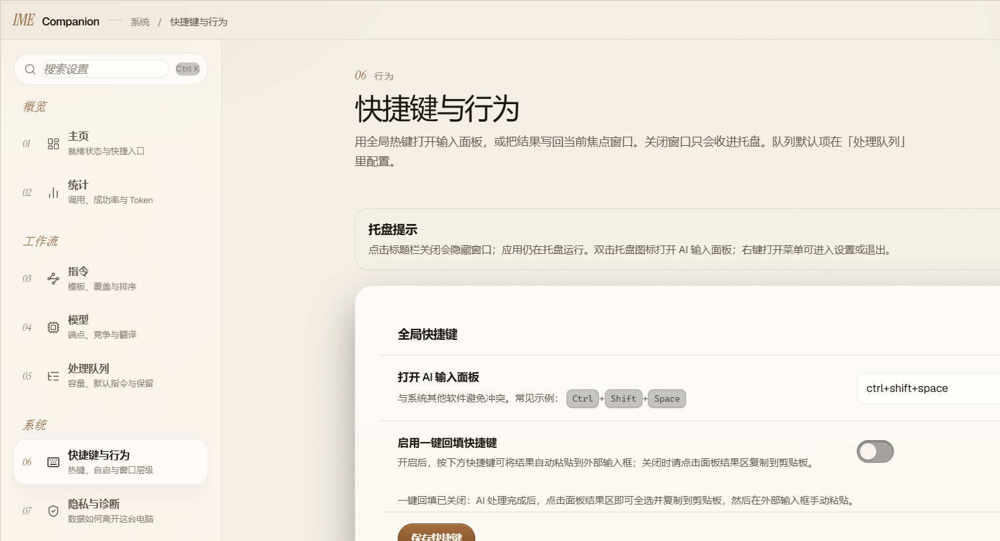

<p align="center">
  <b>中文</b> &nbsp;|&nbsp; <a href="README.en.md">English</a>
</p>

<div align="center">



# IME Companion

**AI 增强 · 输入法伴侣**

在任何软件里一键唤起 AI，写完直接插回光标处。


</div>

---

## ✨ 这是什么

你有没有过这种体验：在写邮件、写文档、回客户消息时，想把一段话润色一下，于是——

> 选中 → 复制 → 切到浏览器 → 打开 AI 网页 → 粘贴 → 等结果 → 复制 → 切回来 → 粘贴

**IME Companion 把这 9 步压缩成 2 步。**

它是一个常驻系统托盘的 Windows 桌面小工具：按一下全局快捷键，一个轻量输入面板就浮在光标附近，输入或粘贴内容、选一个指令，AI 处理完**直接插回你正在打字的地方**。

不打断思路，不切换窗口，不破坏排版。

---

## 📸 效果预览

### 主面板：悬浮在任何软件之上



面板是一个无边框浮窗，会跟随你当前的输入位置出现，输入框、指令选择、结果区都在一屏内完成。

### 动图：唤起 → 输入 → 执行



### 动图：托盘菜单 → 打开设置



右键托盘图标即可看到三个入口：**打开 AI 输入面板 / 打开设置 / 退出**。  
托盘提示为 `IME Companion · AI 增强 — 状态：就绪 · 双击打开面板 · 右键菜单`。



### 动图：设置工作台



设置窗口是一个完整的工作台，包含 **首页 / 模型 / 指令 / 队列 / 外观 / 隐私 / 统计** 七个板块。



---

## 🎯 核心能力

|    | 能力             | 说明                                                                                                         |
| -- | -------------- | ---------------------------------------------------------------------------------------------------------- |
| ⌨️ | **全局唤起**       | 任意软件、任意输入框里，按快捷键直接唤出 AI 面板，无需切窗口                                                                           |
| 📥 | **一键插回**       | 结果生成后自动（或按插入键）粘贴回**你原先聚焦的那个窗口**，光标位置不变                                                                     |
| 🧩 | **内置指令**       | 开箱即用：翻译为中文 / 翻译为英文 / 润色 / 生成摘要 / 扩写 / 纠错                                                                   |
| ✍️ | **自定义指令**      | 自己写提示词，保存为常用指令；支持设为默认指令                                                                                    |
| 🤖 | **多模型接入**      | OpenAI 兼容协议，可接 LM Studio、OpenRouter、OpenAI、DeepSeek、Groq、Together、SiliconFlow、Moonshot、NVIDIA NIM 及任意自定义端点 |
| 🏆 | **模型竞争**       | 可配置多个候选模型并发探测，自动挑选可用/最快的那个作为当前模型                                                                           |
| 🌐 | **传统翻译 API**   | 除大模型外，还可直接走百度翻译、有道翻译、DeepL，无需专用翻译 API 也能翻                                                                  |
| 📋 | **剪贴板 / 选区输入** | 可直接读取剪贴板或当前选中的文字作为输入源                                                                                      |
| 🧷 | **面板置顶策略**     | `default` / `upper` / `always_top` 三种层级模式，面板不会挡住你正在看的内容                                                    |
| 🚀 | **开机自启**       | 随系统启动，托盘常驻，随用随唤                                                                                            |
| 🔤 | **中英文界面**      | 内置 `zh` / `en` 两套 UI 语言                                                                                    |
| 🔒 | **本地优先**       | 配置与密钥保存在本机，不经过任何中间服务器                                                                                      |

---

## 🚀 快速开始

### 1. 安装

1. 到 **Releases** 下载最新的 `ime-ai-companion.exe`（不到 15 MB，绿色单文件）。
2. 双击运行，它不会弹出主窗口——**它住进系统托盘**。
3. Windows 11 / 已更新的 Windows 10 自带 WebView2 运行时；若启动异常，请安装  
   [Microsoft Edge WebView2 Runtime](https://developer.microsoft.com/microsoft-edge/webview2/)。

> 托盘图标可能被 Windows 收进「隐藏的图标」里，点一下任务栏的 `^` 就能找到它。

### 2. 配置一个模型

1. 右键托盘图标 → **打开设置** → **模型**。
2. 选择一个服务商（以 OpenRouter 为例）：
   - `Provider`：`OpenRouter`
   - `Base URL`：`https://openrouter.ai/api/v1`
   - `Model`：例如 `deepseek/deepseek-chat`
   - 填入 API Key
3. 点 **连接测试**，看到连接成功后保存。

想完全离线／本地跑？选 `LM Studio`，`Base URL` 填 `http://localhost:1234/v1` 即可。

### 3. 开始用

- 在任意软件里点一下要输入的地方（微信、Word、邮件、IDE、表单……）
- 按面板快捷键唤出 **AI 增强面板**
- 输入（或粘贴）内容 → 选指令 → 执行
- 结果出来后，用**插入快捷键**把它插回原来的输入框

---

## ⌨️ 快捷键

应用注册了**两组全局快捷键**，都可以在「设置 → 首页」里改成你顺手的组合：

| 快捷键       | 作用                     |
| --------- | ---------------------- |
| **面板快捷键** | 在任何地方唤出 / 收起 AI 增强面板   |
| **插入快捷键** | 把最近一次生成的结果插入到原先聚焦的外部窗口 |

此外：**双击托盘图标**也能打开面板。

> 💡 如果你按下插入键时看到「无法确定要粘贴的目标窗口」，说明当前焦点还在本应用里。  
> 先在目标软件的文本框点一下，再按插入键即可。

---

## 🔌 支持的服务商

全部走 **OpenAI 兼容协议**，填入 `Base URL` + `Model` + `Key` 即可：

| Provider      | 说明                                 |
| ------------- | ---------------------------------- |
| `LM Studio`   | 本地模型，默认 `http://localhost:1234/v1` |
| `OpenRouter`  | 一个 Key 通吃几百个模型，可填站点 URL / 应用名做归因   |
| `OpenAI`      | 官方 API                             |
| `DeepSeek`    | 深度求索                               |
| `Groq`        | 极速推理                               |
| `Together`    | Together AI                        |
| `SiliconFlow` | 硅基流动                               |
| `Moonshot`    | 月之暗面 Kimi                          |
| `NVIDIA NIM`  | NVIDIA 推理微服务                       |
| `Custom`      | 任意 OpenAI 兼容端点（自建网关、代理、vLLM 等均可）   |

### 传统翻译接口（可选）

不想用大模型翻译时，可在「设置」里单独配置：

- **百度翻译**：APP ID + 密钥
- **有道翻译**：appKey + 应用密钥
- **DeepL**：`api.deepl.com` / `api-free.deepl.com`

---

## ⚙️ 配置项

设置保存在本机（Tauri 应用数据目录下的 `settings.json`），主要字段：

```jsonc
{
  "global_shortcut": "…",          // 唤出面板的全局快捷键
  "inject_global_shortcut": "…",   // 插入结果的全局快捷键
  "auto_inject_enabled": true,     // 生成完成后是否自动插入
  "panel_zorder_mode": "always_top", // default | upper | always_top
  "autostart_enabled": true,       // 开机自启
  "openrouter_site_url": "",       // OpenRouter 归因：站点
  "openrouter_app_name": "",       // OpenRouter 归因：应用名
  "competition": {                 // 模型竞争
    "enabled": false,
    "default_command_id": "…",
    "auto_start_on_enqueue": true,
    "max_queue_size": 8,
    "persist_queue": true,
    "unified_command": true
  },
  "queue": { "…": "…" },           // 任务队列
  "translation": { "…": "…" }      // 百度 / 有道 / DeepL
}
```

每个模型条目还包含 `identifier`、`provider`、`base_url`、`model`、`timeout_secs`。

---

## 🧩 使用场景

- **写邮件 / 回消息**：写完一句大白话，一键润色成商务口吻，再插回去
- **跨语言沟通**：中英互译不用打开网页，翻完直接落在对话框里
- **长文处理**：粘贴一大段，生成摘要或扩写
- **纠错**：检查错别字和语病，只输出纠正后的结果
- **代码注释 / 文档**：在 IDE 里唤出面板，写完直接插回编辑器
- **表单填写**：任何网页输入框都能用

---

## 🛠 技术栈

| 层   | 选型                                                     |
| --- | ------------------------------------------------------ |
| 桌面壳 | **Tauri 2**（Rust），窗口类名 `Tauri Window`                  |
| 渲染  | **WebView2**（Chromium），Bundle ID `com.ime.aicompanion` |
| 前端  | 单页应用，路由 `#/panel`（面板）与设置工作台                            |
| 插件  | `global-shortcut`、`autostart`、`opener`、`menu`          |
| 能力  | 系统托盘、全局热键、剪贴板读写、模拟粘贴、流式输出、任务队列                         |

面板路由：`http://tauri.localhost/index.html#/panel`  
设置窗口标题：`AI 增强`　面板窗口标题：`AI 增强面板`

### 安全策略

WebView 使用严格 CSP：

```
default-src 'self';
script-src 'self';
style-src 'self' 'unsafe-inline';
img-src 'self' data: asset:;
connect-src ipc: http://ipc.localhost http://127.0.0.1:* https://* http://localhost:*
```

只有 `tauri://` 与本机 IPC 可通信，避免远程脚本注入。

---

## 🔒 数据与隐私

- 所有配置、API Key 保存在**本机**应用数据目录，不上传。
- 请求直接从你的电脑发往你选择的服务商，应用本身不做中转。
- 提供**隐私**设置板块，可自行管理本地数据。

---

## ❓ 常见问题

**Q：托盘图标找不到？**  
A：Windows 会把它收进「隐藏的图标」。点任务栏右侧的 `^` 展开即可；也可以在系统「任务栏 → 其他系统托盘图标」里把它设为常显。

**Q：按插入键提示「无法确定要粘贴的目标窗口」？**  
A：说明焦点还在本应用窗口内。先点一下目标软件的文本框，再按插入键。

**Q：模型列表拉不出来？**  
A：确认 `Base URL` 是 OpenAI 兼容的 `/v1` 地址，且返回体里有 `data[].id` 列表。

**Q：能不能离线用？**  
A：可以。选 `LM Studio`（或任何本地 OpenAI 兼容服务，如 Ollama 的兼容层、vLLM），Base URL 指向本机即可。

**Q：界面想换成英文？**  
A：「设置 → 外观」里可切换 UI 语言（应用内保存为 `ui_locale`）。

---

## 🗺 Roadmap

- [ ] macOS / Linux 版本
- [ ] 更多内置指令模板市场
- [ ] 结果历史与一键复用
- [ ] 自定义主题
- [ ] 选区自动捕获（不用手动复制）

---

## 📄 License

MIT License. 见 [LICENSE](README/LICENSE)。

---

<div align="center">

如果这个小工具帮你省下了往返复制粘贴的时间，欢迎点个 ⭐

</div>
